# Plated in Gold: What Drives Apple Smartwatch Resale Prices?

<!-- pdf-exclude-start -->
<p align="center">
  <a href="https://andrecdavis.github.io/Plated-In-Gold/report.pdf">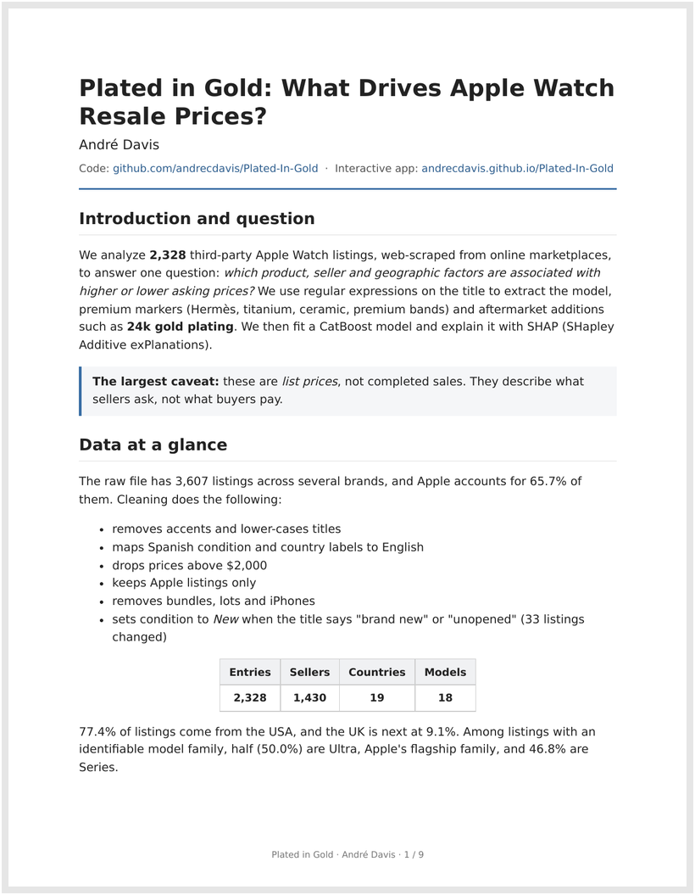</a>
</p>

<p align="center"><b><a href="https://andrecdavis.github.io/Plated-In-Gold/report.pdf">Read the full report (PDF)</a></b> · <a href="https://andrecdavis.github.io/Plated-In-Gold/">Interactive app</a></p>
<!-- pdf-exclude-end -->

**▶ Interactive version: [andrecdavis.github.io/Plated-In-Gold](https://andrecdavis.github.io/Plated-In-Gold/)**. It has filters, a price explorer and a per-listing SHAP explainer.

## Introduction and question

We analyze **2,328** third-party Apple Watch listings, web-scraped from online marketplaces, to answer one question: *which product, seller and geographic factors are associated with higher or lower asking prices?* We use regular expressions on the title to extract the model, premium markers (Hermès, titanium, ceramic, premium bands) and aftermarket additions such as **24k gold plating**. We then fit a CatBoost model and explain it with SHAP (SHapley Additive exPlanations).

> **The largest caveat:** these are *list prices*, not completed sales. They describe what sellers ask, not what buyers pay.

## Contents
1. [Data at a glance](#data-at-a-glance)
2. [The gold-plating pitfall](#the-gold-plating-pitfall)
3. [Modeling: CatBoost](#modeling-catboost)
4. [Explaining the model with SHAP](#explaining-the-model-with-shap)
5. [Key findings](#key-findings)
6. [Limitations](#limitations)
7. [Future work](#future-work)
8. [Project structure and reproduction](#project-structure-and-reproduction)

## Data at a glance

The raw file has 3,607 listings across several brands, and Apple accounts for 65.7% of them. Cleaning does the following:
- removes accents and lower-cases titles
- maps Spanish condition and country labels to English
- drops prices above $2,000
- keeps Apple listings only
- removes bundles, lots and iPhones
- sets condition to *New* when the title says "brand new" or "unopened" (33 listings changed)

| Entries | Sellers | Countries | Models |
|:-:|:-:|:-:|:-:|
| **2,328** | **1,430** | **19** | **18** |

77.4% of listings come from the USA, and the UK is next at 9.1%. Among listings with an identifiable model family, half (50.0%) are Ultra, Apple's flagship family, and 46.8% are Series.

<p align="center">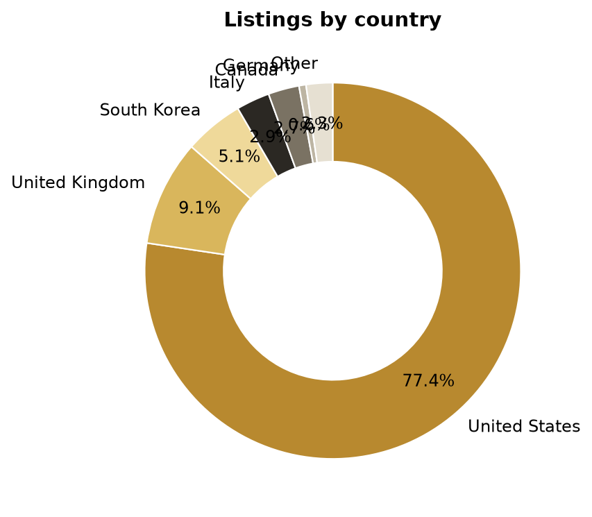 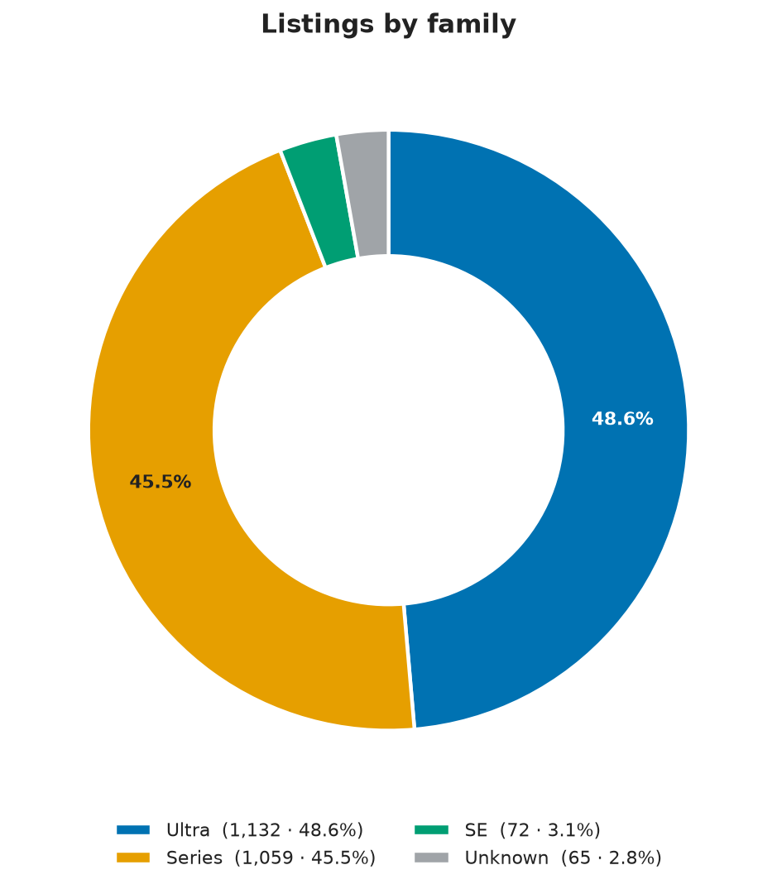</p>

The UK has the lowest average price of any country with 30+ listings. Leaving it out raises the overall average from $578 to $593.

<p align="center">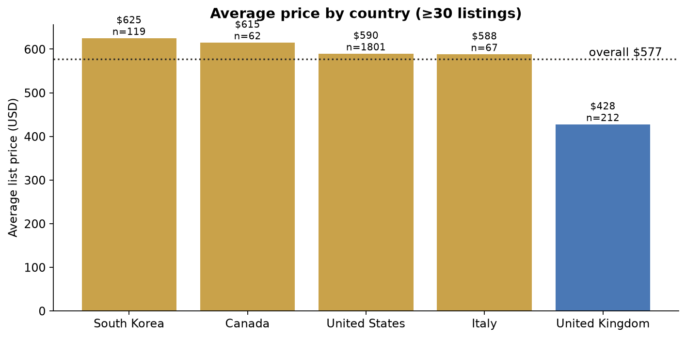</p>

### The UK effect

UK listings average $428, against $593 elsewhere (Welch p = 1.8e-52). This isn't just the UK listing cheaper models. The UK sits below each model's cross-country average in 17 of the 17 models listed there, by $126 on average.

<p align="center">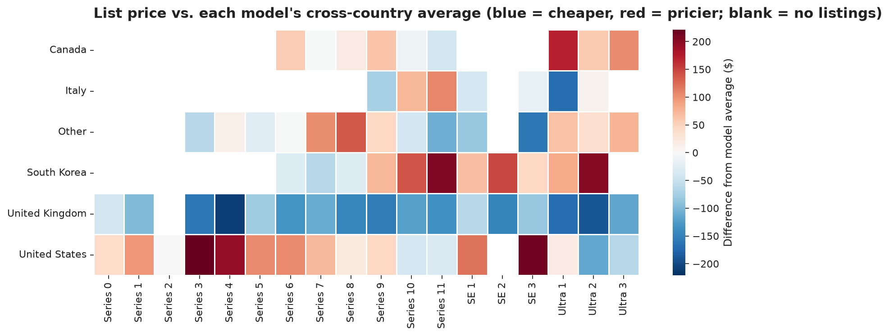</p>

**Listing type.** Individuals (sellers with one listing, n = 1,257) average $561. That is 5.8% less than power sellers with 2+ listings ($596, n = 1,071). The gap is significant (Welch t-test p = 5.1e-8), but it is small inside the model: power_seller ranks 11th of 12 features.

<p align="center">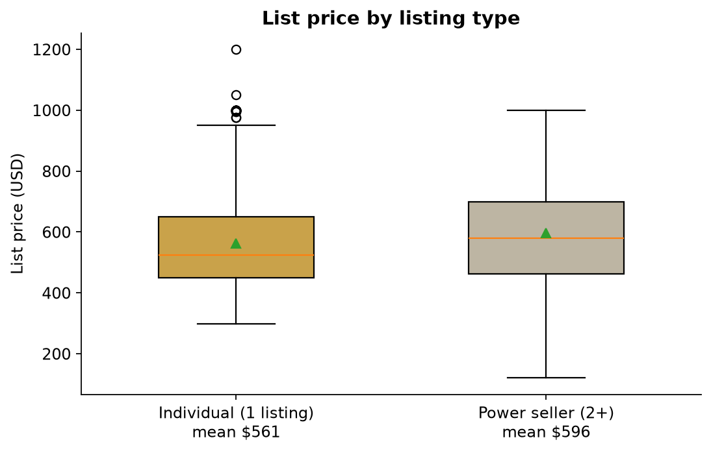</p>

## The gold-plating pitfall

Grouped by model, the outdated **Series 2 ($743), Series 4 ($676) and Series 3 ($664) average more than the current-gen Ultra 3 ($651)**, which ranks 4th of 18.

<p align="center">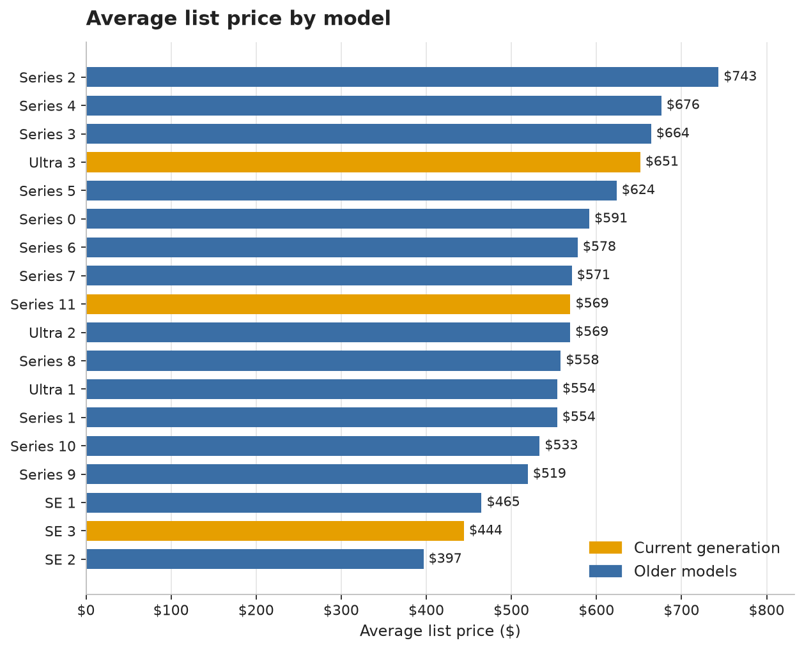</p>

Many of these older listings are aftermarket **24k gold-plated**. The three models with the highest gold share (Series 2 88%, Series 4 51%, Series 3 42%) are also the three highest-priced, and no current-gen listings are gold-plated. Within the 9 models that have gold-plated listings, gold-plated watches average **54.8% ($294) more** than standard ones of the same model (123 gold listings).

<p align="center">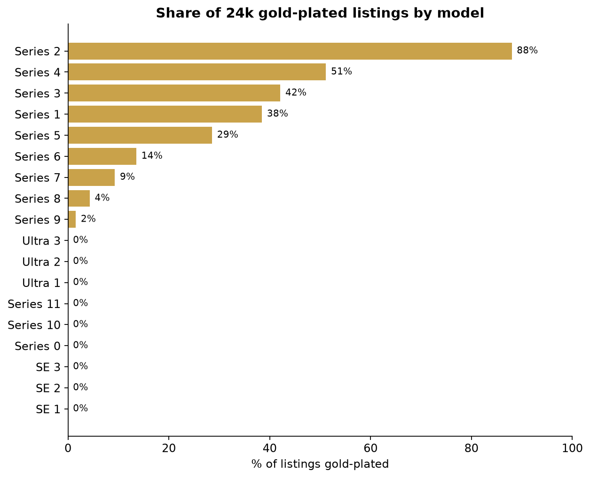</p>

Once gold-plated listings are removed, the Ultra 3 becomes the highest-priced model. Gold doesn't explain everything, though: the standard Series 2 ($615) and Series 3 ($575) still average more than the Series 11 ($569).

<p align="center">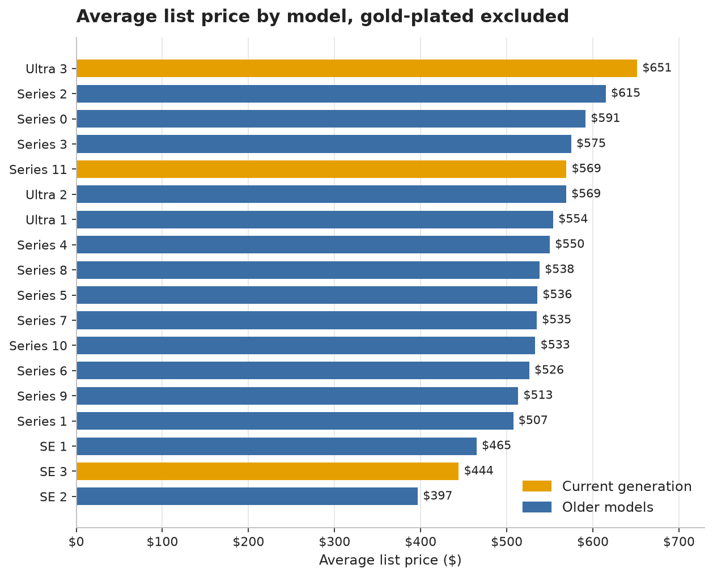</p>

## Modeling: CatBoost

The model setup:
- rows with missing values are dropped first
- the data is split 80/20 with seed 43, giving 1,585 training and 397 test listings
- the model is a CatBoost regressor with default hyperparameters, with model, country, condition and seller ID as categorical features

| Variant | Features | Test R² | MAE |
|---|---|:-:|:-:|
| Headline | condition, case size, worldwide shipping, country, model, Hermès, cellular, gold, premium band, ceramic, seller ID | **0.53** | **$69.40** |
| + power seller | the above + power_seller | 0.52 | $70.02 |

## Explaining the model with SHAP

SHAP comes from game theory. For each listing, it splits the gap between the model's base value ($577) and that listing's prediction into a dollar amount for each feature. Averaging the absolute values over the test set gives a global ranking. **Model ranks first (±$26.94), followed by country ($21.09), condition ($19.03) and seller ID ($18.13).** The same top four appear with or without power_seller.

<p align="center">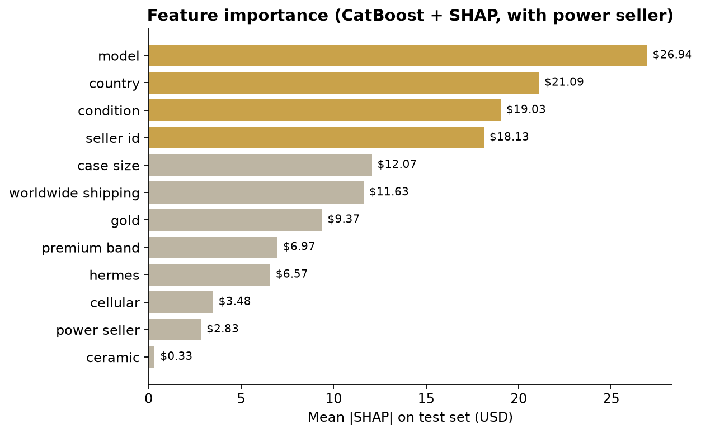</p>

**Two listings, explained.** For a typical US Ultra 3 listing (the one closest to the median price), *model = Ultra 3* adds $62.08, *open box* adds $25.97 and the 49 mm case adds $13.81. No worldwide shipping subtracts $7.69.

<p align="center">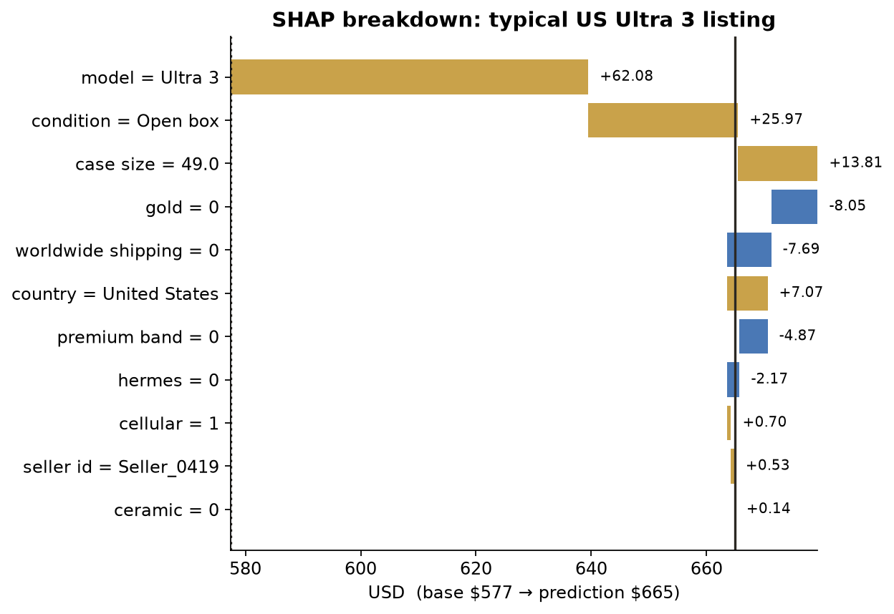</p>

Features interact. In a hypothetical gold-plated Series 2, *gold = 1* adds $47.59 while *model = Series 2* subtracts $25.76.

<p align="center">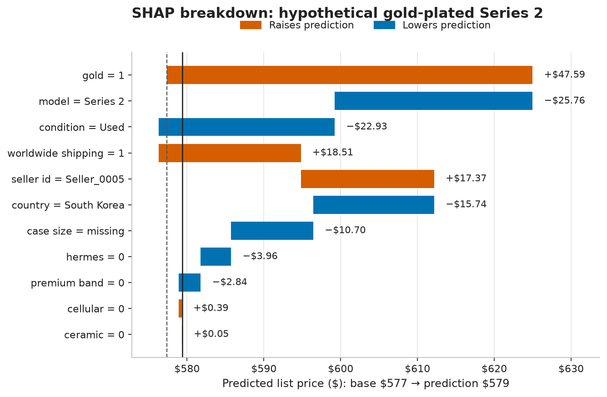</p>

**The UK effect in the model.** UK listings' country SHAP values average −$106, against +$9 for other countries, and **212 of 212 UK listings get a negative country SHAP value** (33 of 33 in the test set). The price gap itself is shown in [The UK effect](#the-uk-effect).

## Key findings

1. **Model is the top feature, but simple comparisons mislead.** Series 2, 4 and 3 average more than the Ultra 3, and they have the highest gold-plating shares.
2. **A feature can matter a lot in a niche and little overall.** Gold-plating goes with a 54.8% within-model premium, yet it ranks only 7th of 12 by mean |SHAP| ($9.37), because it affects just 123 listings.
3. **Country is a large source of variation.** It ranks 2nd. The UK is below the cross-country average in 17 of 17 models, and 212 of 212 UK listings get a negative country SHAP value.

## Limitations

1. **Listings, not completed sales.** A high list price doesn't mean a watch sold for that amount.
2. **Missing variables.** The CSV has 8 columns (brand, condition, case size, country, price, seller ID, worldwide shipping, title). It has no description or sale price, so other product details come from the title alone.
3. **Web-scraped data quality.** Labels came in mixed languages, and 33 condition/title conflicts needed fixing. Regex extraction can miss features: 65 listings have no detectable model.

## Future work

- Analyze seller ID in more detail: do power sellers over- or under-price?
- Re-scrape the same marketplaces over time to see how long listings stay up and to estimate sale prices.

## Project structure and reproduction

```bash
python -m venv .venv && source .venv/bin/activate
pip install -r requirements.txt
make figures    # regenerate images/ from data/raw/
make notebook   # execute notebooks/01_plated_in_gold_analysis.ipynb top to bottom
make app        # build the app data (app/data.js)
make serve      # http://localhost:8000
```

```
├── data/raw/Global_Smartwatch_Marketplace.csv   raw scraped listings
├── src/            cleaning, features, data loading, CatBoost + SHAP modeling, summary statistics, visualization
├── notebooks/      01_plated_in_gold_analysis.ipynb (final analysis, with outputs)
├── images/         figures generated by scripts/make_figures.py
├── app/            interactive site (published by GitHub Pages) and its data build script
├── scripts/        figure, notebook and PDF report generation; headless-browser test of the app
├── reports/        PDF report output (generated by make pdf; not tracked)
└── Makefile, requirements.txt
```

### PDF report

A print-ready summary of this README (US Letter, with figures) can be built with `make pdf`, which writes `reports/Plated_in_Gold_Andre_Davis.pdf`. It requires [pandoc](https://pandoc.org) and Google Chrome or Chromium; the browser is detected automatically on macOS and Linux, or can be set with the `CHROME` environment variable. On macOS:

```bash
brew install pandoc                     # Chrome: install from google.com/chrome if not present
source .venv/bin/activate
make pdf                                # or: CHROME="/path/to/chrome" make pdf
```

The print layout is defined in `scripts/pdf_style.css`.

*License: MIT*
